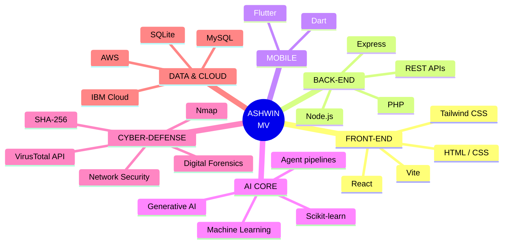
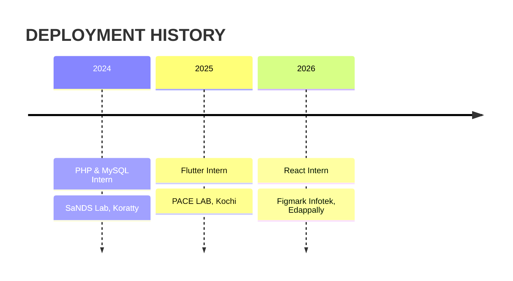

<div align="center">


<a href="https://github.com/Ashwinmv123">
  
</a>

<br/>


<br/><br/>

<a href="https://www.linkedin.com/in/ashwin-mv112"></a>
<a href="mailto:ashwinmv67@gmail.com"></a>


</div>


## ◢ BOOT SEQUENCE

```bash
$ ./boot_ashwin.sh

[ OK ] Loading identity .............. Ashwin MV
[ OK ] Locating base ................. Thrissur, Kerala, India 🇮🇳
[ OK ] Mounting education ............ B.Tech CSE · Nirmala College of Engineering (2023 - Present)
[ OK ] Loading modules ............... AI/ML · Cybersecurity · Web · Mobile
[ OK ] Syncing experience ............ 3 internships · 2 hackathons · 2 certifications
[ OK ] Language packs ................ English · Hindi · Malayalam
[ .. ] Training in background ........ Generative AI · Robotics
[ OK ] Relocation module ............. ENABLED

>> ALL SYSTEMS NOMINAL. READY FOR DEPLOYMENT.
```

<div align="center">

| 🛰️ MISSIONS | 🧬 INTERNSHIPS | ⚔️ HACKATHONS | 🛡️ CERTIFICATIONS |
|:-:|:-:|:-:|:-:|
| **3** projects | **3** roles | **2** events | **2** programs |

</div>


## ◢ NEURAL NETWORK · SKILLS



<div align="center">


<br/><br/>


</div>


## ◢ ACTIVE MISSIONS · PROJECTS

<div align="center">
  <a href="https://github.com/Ashwinmv123/sage-ai"></a>
  <a href="https://github.com/Ashwinmv123/FLAG-CLEANUP-AGENT"></a>
</div>

<br/>

<details open>
<summary><b>🛡️ MISSION 01 · SAGE AI</b> — Digital Safety & Harassment Response Platform</summary>
<br/>

> `React` `Vite` `Tailwind CSS` `Node.js` `Express` `SQLite`

**Objective:** help students and vulnerable users respond to cyberstalking, phishing, extortion and impersonation.

| MODULE | CAPABILITY |
|:--|:--|
| 🔎 Threat Engine | Explainable threat analysis with severity scoring |
| 🔐 Evidence Vault | Tamper-evident storage using SHA-256 hashing and forensic metadata |
| 📄 Report Generator | Printable cyber-crime report for police / cyber cells, plus incident tracking |
| 🕶️ Stealth Mode | Quick-exit disguise mode |
| 🗝️ Access Control | REST API with user authentication |

</details>

<details open>
<summary><b>🧹 MISSION 02 · FLAG BUSTER</b> — Dead Code Cleanup Agent</summary>
<br/>

> `Node.js` `IBM Bob` `Vercel`


Multi-agent pipeline that finds stale feature flags and unreachable code and proposes safe removals, with schema-validated JSON handoffs, a safe dry-run mode, failure handling, unit tests and a live demo on Vercel.

</details>

<details>
<summary><b>🦠 MISSION 03 · SECURESHIELD AI</b> — Hybrid Security Dashboard</summary>
<br/>

> `Python` `Machine Learning` `Nmap` `VirusTotal API`

- Desktop antivirus that detects malware using machine learning and the VirusTotal API
- Live Nmap network scanner that flags vulnerable system services against known CVEs

</details>


## ◢ MISSION LOG · EXPERIENCE



<details>
<summary><b>📂 OPEN FULL LOGS</b></summary>
<br/>

| ROLE | ORGANISATION | WINDOW | BASE | OUTCOME |
|:--|:--|:--|:--|:--|
| Web Development using React Intern | Figmark Infotek Pvt Ltd | 15–30 Jun 2026 | Edappally, Ernakulam | Built and improved web interfaces with HTML, CSS, JavaScript and React |
| Flutter Intern | PACE LAB | 26 Jun – 9 Jul 2025 | Kochi | Built cross-platform mobile interfaces and features with Flutter and Dart |
| PHP & MySQL Intern | SaNDS Lab | 8–12 Jul 2024 | Trichur Infopark, Koratty | Server-side web development and database-driven apps |

</details>


## ◢ ACCESS GRANTED · ACHIEVEMENTS

<div align="center">

| | CLEARANCE | DETAILS |
|:-:|:--|:--|
| 🤖 | **IBM Bob 2.0 Hackathon** | Certificate of Completion for outstanding performance · LabLab.ai / NativelyAI · 25–27 Sep 2026 · built on Anthropic Claude and Antigravity |
| 💡 | **Hack2Pitch, FISAT** | Certificate of Achievement for innovation, creativity and collaborative problem-solving |
| 🔐 | **Introduction to Cybersecurity** | Cisco Networking Academy · Oct 2026 |
| 🚔 | **Cyber First Responder Awareness** | Kerala Police, Cyber Division · Cyber Safety Pledge |

</div>


## ◢ TELEMETRY · GITHUB STATS

<div align="center">


</div>


## ◢ TRAINING DATA · EDUCATION

<div align="center">

| DEGREE | INSTITUTION | YEAR | SCORE |
|:--|:--|:-:|:-:|
| B.Tech, Computer Science and Engineering | Nirmala College of Engineering, Chalakudy | 2023 – Present | In progress |
| Higher Secondary (XII) | St George's HSS, Pariyaram | 2023 | 80% |
| Secondary (X) | St George's HSS, Pariyaram | 2021 | 9 A+ and 1 A |

</div>

## ◢ UPGRADES IN PROGRESS

```text
[██████████] Full-Stack Web   ▸ React · Node.js · Express          ONLINE
[██████████] Mobile           ▸ Flutter · Dart                     ONLINE
[█████████░] Cyber-Defense    ▸ Nmap · Forensics · Threat Analysis ACTIVE
[████████░░] AI Core          ▸ ML · Generative AI · Agents        ACTIVE
[████░░░░░░] Robotics         ▸ Fundamentals                       LOADING
```

<sub>Bars are a visual guide to where my current focus is, not a formal rating.</sub>

<div align="center">

<br/>

<a href="https://github.com/Ashwinmv123">
  
</a>

<a href="mailto:ashwinmv67@gmail.com"></a>
<a href="https://www.linkedin.com/in/ashwin-mv112"></a>

</div>


