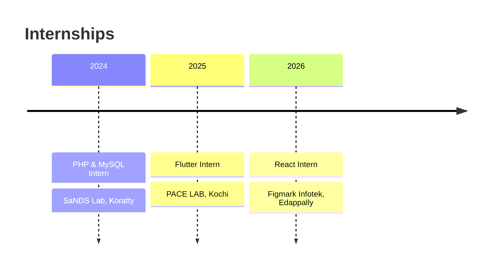

<div align="center">


<a href="https://github.com/Ashwinmv123">
  
</a>

<br/><br/>

<a href="https://www.linkedin.com/in/ashwin-mv112"></a>
<a href="mailto:ashwinmv67@gmail.com"></a>
<a href="https://github.com/Ashwinmv123?tab=repositories"></a>


</div>

<br/>

## ✨ At a Glance

<table align="center">
<tr>
<td align="center" width="25%"><h3>🎓</h3><b>B.Tech CSE</b><br/><sub>Nirmala College of Engineering<br/>2023 – Present</sub></td>
<td align="center" width="25%"><h3>🛡️</h3><b>Security + AI</b><br/><sub>Threat analysis, forensics,<br/>ML malware detection</sub></td>
<td align="center" width="25%"><h3>💼</h3><b>3 Internships</b><br/><sub>React · Flutter · PHP/MySQL</sub></td>
<td align="center" width="25%"><h3>🌍</h3><b>Open to Relocate</b><br/><sub>Global, cross-sectoral<br/>opportunities</sub></td>
</tr>
</table>

## 🙋 About Me

I'm a computer science undergraduate from **Thrissur, Kerala** with a foundation in **AI, machine learning, cybersecurity and web/mobile development**. I like turning security problems into usable products: from an evidence vault that proves a file wasn't tampered with, to an antivirus that combines ML with live network scanning.

I'm currently looking for an **entry-level role or a long-term (6-month) internship** where I can build practical experience on a dynamic team.

## 🎯 Why Work With Me

| | |
|:--|:--|
| 🔐 **Security mindset** | Built a tamper-evident evidence vault (SHA-256), a Nmap CVE scanner and a VirusTotal-powered antivirus. Completed Cisco's Intro to Cybersecurity and Kerala Police's Cyber First Responder programme |
| 🧩 **Full-stack range** | Shipped with React, Vite, Tailwind, Node.js, Express and SQLite, plus Flutter for mobile and PHP/MySQL on the server side |
| 🤖 **AI-agent experience** | Designed a multi-agent pipeline with schema-validated JSON contracts, and built hackathon solutions with Anthropic Claude and IBM Bob |
| 🚀 **Fast learner** | Three internships in three different stacks, plus hackathon recognition at IBM Bob 2.0 and Hack2Pitch |

## 🧰 Tech Stack

<div align="center">


<br/><br/>


</div>

## 🚀 Featured Projects

<table>
<tr>
<td width="50%" valign="top">

#### 🛡️ [Sage AI](https://github.com/Ashwinmv123/sage-ai)
**Digital Safety & Harassment Response Platform**

`React` `Vite` `Tailwind` `Node.js` `Express` `SQLite`

Helps students and vulnerable users respond to cyberstalking, phishing, extortion and impersonation.

- Explainable threat analysis with severity scoring
- Tamper-evident evidence vault (SHA-256 + forensic metadata)
- Printable cyber-crime report for police / cyber cells
- Quick-exit disguise mode, authenticated REST API

</td>
<td width="50%" valign="top">

#### 🧹 [Flag Buster](https://github.com/Ashwinmv123/FLAG-CLEANUP-AGENT)
**Dead Code Cleanup Agent**

`Node.js` `IBM Bob` `Vercel`

Multi-agent pipeline (scanner → analyzer → reporter → cleaner) that finds stale feature flags and unreachable code and proposes safe removals.

- JSON handoff contracts with schema validation
- Safe dry-run mode, failure handling, unit tests
- Live demo hosted on Vercel

</td>
</tr>
<tr>
<td colspan="2" valign="top">

#### 🦠 SecureShield AI
**Hybrid Security Dashboard** · `Python` `Machine Learning` `Nmap` `VirusTotal API`

Desktop antivirus that detects malware using machine learning and the VirusTotal API, with a live Nmap scanner that flags vulnerable services against known CVEs.

</td>
</tr>
</table>

<div align="center">
  <a href="https://github.com/Ashwinmv123/sage-ai"></a>
  <a href="https://github.com/Ashwinmv123/FLAG-CLEANUP-AGENT"></a>
</div>

## 💼 Experience



<details>
<summary><b>Web Development using React Intern</b> · Figmark Infotek Pvt Ltd · 15–30 Jun 2026 · Edappally, Ernakulam</summary>

- Built and improved web application interfaces
- Applied HTML, CSS, JavaScript and React in practical projects

</details>

<details>
<summary><b>Flutter Intern</b> · PACE LAB · 26 Jun – 9 Jul 2025 · Kochi</summary>

- Two-week internship building cross-platform mobile app interfaces and features with Flutter and Dart

</details>

<details>
<summary><b>PHP & MySQL Intern</b> · SaNDS Lab · 8–12 Jul 2024 · Trichur Infopark, Koratty</summary>

- Practical exposure to server-side web development and database-driven applications

</details>

## 🏆 Recognition

<table>
<tr>
<td width="50%" valign="top">

**🤖 IBM Bob 2.0 Hackathon**
LabLab.ai / NativelyAI · 25–27 Sep 2026
Certificate of Completion for outstanding performance, with a solution built on Anthropic Claude and Antigravity.

</td>
<td width="50%" valign="top">

**💡 Hack2Pitch, FISAT**
Certificate of Achievement for innovation, creativity and collaborative problem-solving.

</td>
</tr>
<tr>
<td valign="top">

**🔐 Introduction to Cybersecurity**
Cisco Networking Academy · Oct 2026

</td>
<td valign="top">

**🚔 Cyber First Responder Awareness Programme**
Kerala Police, Cyber Division · Cyber Safety Pledge

</td>
</tr>
</table>

## 📊 GitHub Activity

<div align="center">
  
  
  <br/>
  
  <br/>
  
  <br/>
  
</div>

<!-- Optional snake (needs snake.yml workflow) -->
<div align="center">
  <picture>
    <source media="(prefers-color-scheme: dark)" srcset="https://raw.githubusercontent.com/Ashwinmv123/Ashwinmv123/output/github-snake-dark.svg"/>
    
  </picture>
</div>

## 🎓 Education & Learning

<div align="center">

| Degree | Institution | Year | Score |
|:--|:--|:-:|:-:|
| B.Tech, Computer Science and Engineering | Nirmala College of Engineering, Chalakudy | 2023 – Present | In progress |
| Higher Secondary (XII) | St George's HSS, Pariyaram | 2023 | 80% |
| Secondary (X) | St George's HSS, Pariyaram | 2021 | 9 A+ and 1 A |

</div>

```text
🌱 Currently exploring
  🧠 Generative AI     → AI agent pipelines · Anthropic Claude · IBM Bob
  🤖 Robotics          → fundamentals · hands-on builds
  🛡️ Cybersecurity     → network security · Nmap · threat analysis
  🔍 Digital Forensics → evidence integrity · SHA-256
```

**🗣️ Languages:** English · Hindi · Malayalam

<div align="center">

### 📬 Let's talk

<a href="mailto:ashwinmv67@gmail.com"></a>
<a href="https://www.linkedin.com/in/ashwin-mv112"></a>

</div>


