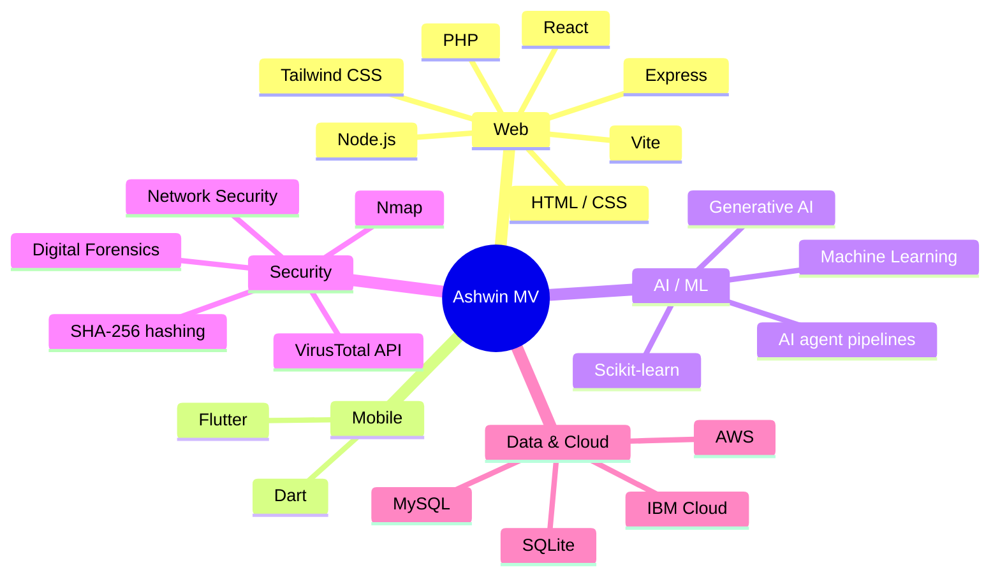
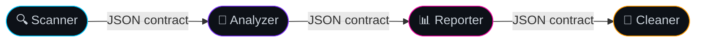
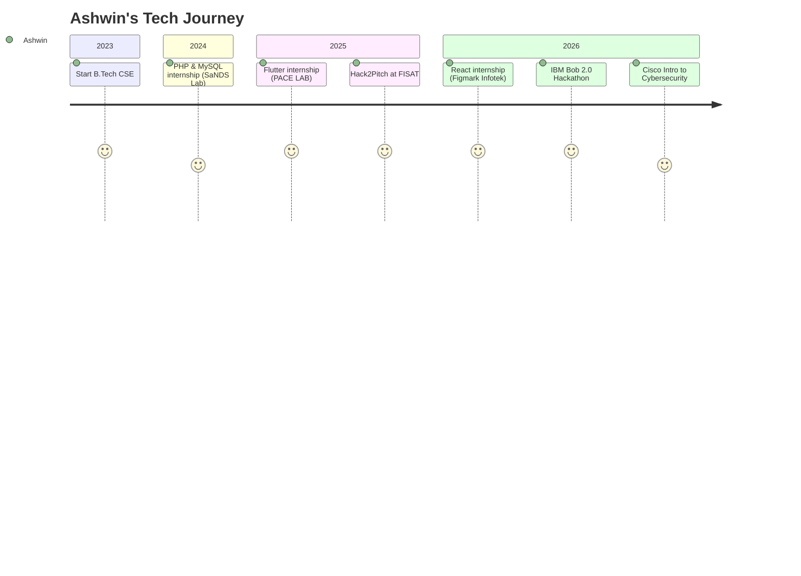

<div align="center">


<a href="https://github.com/Ashwinmv123">
  
</a>

<br/>

<a href="https://www.linkedin.com/in/ashwin-mv112"></a>
<a href="mailto:ashwinmv67@gmail.com"></a>
<a href="https://github.com/Ashwinmv123?tab=repositories"></a>


<br/><br/>


</div>


## 🧬 Who Am I

<table>
<tr>
<td width="58%" valign="top">

```ts
type Developer = {
  name: "Ashwin MV";
  from: "Thrissur, Kerala 🇮🇳";
  studying: "B.Tech CSE · Nirmala College of Engineering";
  superpowers: ["AI / ML", "Cybersecurity", "Full-Stack", "Mobile"];
  speaks: ["English", "Hindi", "Malayalam"];
  exploring: ["Generative AI", "Robotics"];
  seeking: "Entry-level role | 6-month internship";
  relocate: true;
};

const motto = () => "Make the internet safer, one tool at a time. 🔐";
```

</td>
<td width="42%" align="center" valign="middle">

<br/><br/>
<br/><br/>
<br/><br/>


</td>
</tr>
</table>

<div align="center">
  
</div>


## 🧠 Skill Map



<div align="center">


<br/><br/>


</div>


## 🚀 Featured Projects

<div align="center">
  <a href="https://github.com/Ashwinmv123/sage-ai"></a>
  <a href="https://github.com/Ashwinmv123/FLAG-CLEANUP-AGENT"></a>
</div>

<br/>

<details open>
<summary><b>🛡️ Sage AI</b> · Digital Safety & Harassment Response Platform</summary>
<br/>

> `React` `Vite` `Tailwind CSS` `Node.js` `Express` `SQLite`

Helps students and vulnerable users respond to **cyberstalking, phishing, extortion and impersonation**.

- 🔎 Explainable threat-analysis engine with severity scoring
- 🔐 Tamper-evident evidence vault using SHA-256 hashing and forensic metadata
- 📄 Incident tracking and a printable cyber-crime report generator for police / cyber cells
- 🕶️ Quick-exit disguise mode and a REST API with user authentication

</details>

<details open>
<summary><b>🧹 Flag Buster</b> · Dead Code Cleanup Agent</summary>
<br/>

> `Node.js` `IBM Bob` `Vercel`



- Finds stale feature flags and unreachable code, then proposes safe removals
- Schema-validated JSON handoffs, safe dry-run mode, failure handling and unit tests
- Live demo hosted on Vercel

</details>

<details>
<summary><b>🦠 SecureShield AI</b> · Hybrid Security Dashboard</summary>
<br/>

> `Python` `Machine Learning` `Nmap` `VirusTotal API`

- Desktop antivirus that detects malware using machine learning and the VirusTotal API
- Live Nmap network scanner that flags vulnerable system services against known CVEs

</details>


## 🗺️ Journey



<details>
<summary><b>💼 Internship details</b></summary>
<br/>

| Role | Company | When | Where | What I did |
|:--|:--|:--|:--|:--|
| Web Development using React Intern | Figmark Infotek Pvt Ltd | 15–30 Jun 2026 | Edappally, Ernakulam | Built and improved web interfaces with HTML, CSS, JavaScript and React |
| Flutter Intern | PACE LAB | 26 Jun – 9 Jul 2025 | Kochi | Built cross-platform mobile interfaces and features with Flutter and Dart |
| PHP & MySQL Intern | SaNDS Lab | 8–12 Jul 2024 | Trichur Infopark, Koratty | Server-side web development and database-driven applications |

</details>

## 🏆 Achievements

<div align="center">

| | Achievement | Details |
|:-:|:--|:--|
| 🤖 | **IBM Bob 2.0 Hackathon** | Certificate of Completion for outstanding performance · LabLab.ai / NativelyAI · 25–27 Sep 2026 · built on Anthropic Claude and Antigravity |
| 💡 | **Hack2Pitch, FISAT** | Certificate of Achievement for innovation, creativity and collaborative problem-solving |
| 🔐 | **Introduction to Cybersecurity** | Cisco Networking Academy · Oct 2026 |
| 🚔 | **Cyber First Responder Awareness** | Kerala Police, Cyber Division · Cyber Safety Pledge |

</div>


## 📊 GitHub Analytics

<div align="center">


</div>


## 🎓 Education & Learning

<div align="center">

| Degree | Institution | Year | Score |
|:--|:--|:-:|:-:|
| B.Tech, Computer Science and Engineering | Nirmala College of Engineering, Chalakudy | 2023 – Present | In progress |
| Higher Secondary (XII) | St George's HSS, Pariyaram | 2023 | 80% |
| Secondary (X) | St George's HSS, Pariyaram | 2021 | 9 A+ and 1 A |

</div>

```text
🌱 CURRENTLY LEVELING UP
 ├─ 🧠 Generative AI     → AI agent pipelines · Anthropic Claude · IBM Bob
 ├─ 🤖 Robotics          → fundamentals · hands-on builds
 ├─ 🛡️ Cybersecurity     → network security · Nmap · threat analysis
 └─ 🔍 Digital Forensics → evidence integrity · SHA-256 hashing
```

<details>
<summary><b>🎁 Quick facts (click)</b></summary>
<br/>

- 🌍 I speak English, Hindi and Malayalam
- 🛡️ I've completed Kerala Police's Cyber First Responder Awareness Programme and signed the Cyber Safety Pledge
- 🏁 My first internship (PHP & MySQL) was in 2024; by 2026 I'd added Flutter and React
- 🎯 I'm open to global, cross-sectoral opportunities

</details>


<div align="center">

<a href="https://github.com/Ashwinmv123">
  
</a>

<a href="mailto:ashwinmv67@gmail.com"></a>
<a href="https://www.linkedin.com/in/ashwin-mv112"></a>

</div>


