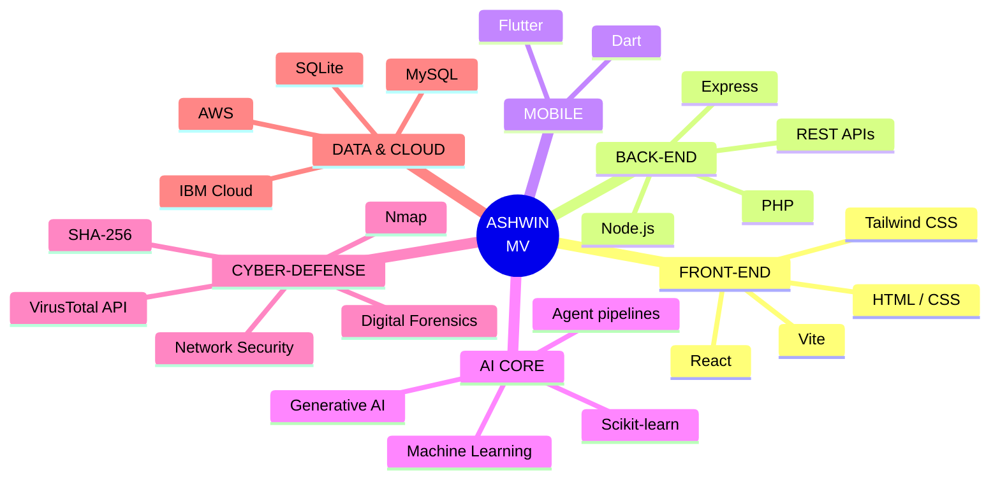
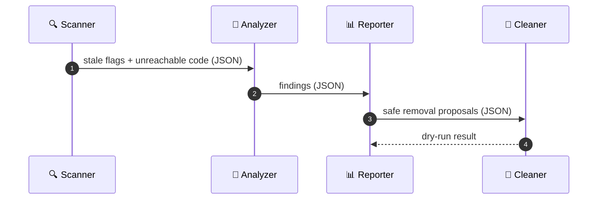
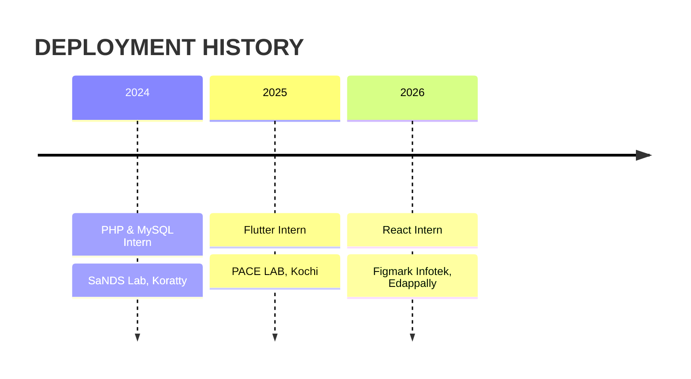

<div align="center">


<a href="https://github.com/Ashwinmv123">
  
</a>

<br/>

<table>
<tr>
<td align="center" width="25%"><br/><sub><b>PILOT</b></sub></td>
<td align="center" width="25%"><br/><sub><b>AI CO-PILOT</b></sub></td>
<td align="center" width="25%"><br/><sub><b>SIGNATURE</b></sub></td>
<td align="center" width="25%"><a href="https://www.linkedin.com/in/ashwin-mv112"></a><br/><sub><b>SCAN TO LINK</b></sub></td>
</tr>
</table>


<br/><br/>

<a href="https://www.linkedin.com/in/ashwin-mv112"></a>
<a href="mailto:ashwinmv67@gmail.com"></a>
<a href="https://github.com/Ashwinmv123?tab=repositories"></a>

</div>


<!-- Live typing boot log (types itself line by line and loops) -->
<div align="center">
  
</div>

<div align="center">

| 🛰️ PROJECTS | 🧬 INTERNSHIPS | ⚔️ HACKATHONS | 🛡️ CERTIFICATIONS | 🗣️ LANGUAGES |
|:-:|:-:|:-:|:-:|:-:|
| **3** | **3** | **2** | **2** | **3** (EN · HI · ML) |

</div>


<div align="center">

**🔮 Drag to rotate this live 3D crystal** *(renders on github.com)*

</div>

```stl
solid hologram
  facet normal 0 0 0
    outer loop
      vertex 10 0 0
      vertex 0 10 0
      vertex 0 0 10
    endloop
  endfacet
  facet normal 0 0 0
    outer loop
      vertex -10 0 0
      vertex 0 0 10
      vertex 0 10 0
    endloop
  endfacet
  facet normal 0 0 0
    outer loop
      vertex 10 0 0
      vertex 0 0 10
      vertex 0 -10 0
    endloop
  endfacet
  facet normal 0 0 0
    outer loop
      vertex -10 0 0
      vertex 0 -10 0
      vertex 0 0 10
    endloop
  endfacet
  facet normal 0 0 0
    outer loop
      vertex 10 0 0
      vertex 0 0 -10
      vertex 0 10 0
    endloop
  endfacet
  facet normal 0 0 0
    outer loop
      vertex -10 0 0
      vertex 0 10 0
      vertex 0 0 -10
    endloop
  endfacet
  facet normal 0 0 0
    outer loop
      vertex 10 0 0
      vertex 0 -10 0
      vertex 0 0 -10
    endloop
  endfacet
  facet normal 0 0 0
    outer loop
      vertex -10 0 0
      vertex 0 0 -10
      vertex 0 -10 0
    endloop
  endfacet
endsolid hologram
```




<div align="center">


<br/><br/>


</div>


<table>
<tr>
<td width="110" align="center" valign="top">
<br/><sub>MISSION 01</sub>
</td>
<td valign="top">

### 🛡️ [Sage AI](https://github.com/Ashwinmv123/sage-ai)
**Digital Safety & Harassment Response Platform** · `React` `Vite` `Tailwind CSS` `Node.js` `Express` `SQLite`

Helps students and vulnerable users respond to cyberstalking, phishing, extortion and impersonation.

- 🔎 Explainable threat analysis with severity scoring
- 🔐 Tamper-evident evidence vault (SHA-256 hashing + forensic metadata)
- 📄 Incident tracking and a printable cyber-crime report for police / cyber cells
- 🕶️ Quick-exit disguise mode and an authenticated REST API

</td>
</tr>
<tr>
<td width="110" align="center" valign="top">
<br/><sub>MISSION 02</sub>
</td>
<td valign="top">

### 🧹 [Flag Buster](https://github.com/Ashwinmv123/FLAG-CLEANUP-AGENT)
**Dead Code Cleanup Agent** · `Node.js` `IBM Bob` `Vercel`

Multi-agent pipeline that finds stale feature flags and unreachable code and proposes safe removals.

- 📜 JSON handoff contracts with schema validation
- 🧪 Safe dry-run mode, failure handling and unit tests
- 🌐 Live demo hosted on Vercel

</td>
</tr>
<tr>
<td width="110" align="center" valign="top">
<br/><sub>MISSION 03</sub>
</td>
<td valign="top">

### 🦠 SecureShield AI
**Hybrid Security Dashboard** · `Python` `Machine Learning` `Nmap` `VirusTotal API`

Desktop antivirus that detects malware using machine learning and the VirusTotal API, with a live Nmap scanner that flags vulnerable system services against known CVEs.

</td>
</tr>
</table>



<div align="center">
  <a href="https://github.com/Ashwinmv123/sage-ai"></a>
  <a href="https://github.com/Ashwinmv123/FLAG-CLEANUP-AGENT"></a>
</div>


<div align="center">

**📍 My Kerala route: home, college and internship locations** *(interactive map on github.com; pins are approximate)*

</div>

```geojson
{
  "type": "FeatureCollection",
  "features": [
    {
      "type": "Feature",
      "properties": { "title": "Thrissur · Home base", "marker-color": "#00F0FF", "marker-symbol": "star", "marker-size": "large" },
      "geometry": { "type": "Point", "coordinates": [76.2144, 10.5276] }
    },
    {
      "type": "Feature",
      "properties": { "title": "Chalakudy · Nirmala College of Engineering", "marker-color": "#7B2FF7", "marker-symbol": "college" },
      "geometry": { "type": "Point", "coordinates": [76.3333, 10.3069] }
    },
    {
      "type": "Feature",
      "properties": { "title": "Koratty · PHP & MySQL Intern, SaNDS Lab (2024)", "marker-color": "#FF00E5", "marker-symbol": "1" },
      "geometry": { "type": "Point", "coordinates": [76.35, 10.27] }
    },
    {
      "type": "Feature",
      "properties": { "title": "Kochi · Flutter Intern, PACE LAB (2025)", "marker-color": "#FF00E5", "marker-symbol": "2" },
      "geometry": { "type": "Point", "coordinates": [76.2673, 9.9312] }
    },
    {
      "type": "Feature",
      "properties": { "title": "Edappally · React Intern, Figmark Infotek (2026)", "marker-color": "#FF00E5", "marker-symbol": "3" },
      "geometry": { "type": "Point", "coordinates": [76.3085, 10.0261] }
    },
    {
      "type": "Feature",
      "properties": { "title": "Journey path", "stroke": "#00F0FF", "stroke-width": 3, "stroke-opacity": 0.8 },
      "geometry": { "type": "LineString", "coordinates": [[76.2144, 10.5276], [76.3333, 10.3069], [76.35, 10.27], [76.3085, 10.0261], [76.2673, 9.9312]] }
    }
  ]
}
```



<details>
<summary><b>📂 OPEN FULL LOGS</b></summary>
<br/>

| ROLE | ORGANISATION | WINDOW | BASE | OUTCOME |
|:--|:--|:--|:--|:--|
| Web Development using React Intern | Figmark Infotek Pvt Ltd | 15–30 Jun 2026 | Edappally, Ernakulam | Built and improved web interfaces with HTML, CSS, JavaScript and React |
| Flutter Intern | PACE LAB | 26 Jun – 9 Jul 2025 | Kochi | Built cross-platform mobile interfaces and features with Flutter and Dart |
| PHP & MySQL Intern | SaNDS Lab | 8–12 Jul 2024 | Trichur Infopark, Koratty | Server-side web development and database-driven apps |

</details>


<div align="center">

| | CLEARANCE | DETAILS |
|:-:|:--|:--|
| 🤖 | **IBM Bob 2.0 Hackathon** | Certificate of Completion for outstanding performance · LabLab.ai / NativelyAI · 25–27 Sep 2026 · built on Anthropic Claude and Antigravity |
| 💡 | **Hack2Pitch, FISAT** | Certificate of Achievement for innovation, creativity and collaborative problem-solving |
| 🔐 | **Introduction to Cybersecurity** | Cisco Networking Academy · Oct 2026 |
| 🚔 | **Cyber First Responder Awareness** | Kerala Police, Cyber Division · Cyber Safety Pledge |

</div>


<div align="center">


</div>


<div align="center">

| DEGREE | INSTITUTION | YEAR | SCORE |
|:--|:--|:-:|:-:|
| B.Tech, Computer Science and Engineering | Nirmala College of Engineering, Chalakudy | 2023 – Present | In progress |
| Higher Secondary (XII) | St George's HSS, Pariyaram | 2023 | 80% |
| Secondary (X) | St George's HSS, Pariyaram | 2021 | 9 A+ and 1 A |

</div>

```text
[██████████] Full-Stack Web   ▸ React · Node.js · Express          ONLINE
[██████████] Mobile           ▸ Flutter · Dart                     ONLINE
[█████████░] Cyber-Defense    ▸ Nmap · Forensics · Threat Analysis ACTIVE
[████████░░] AI Core          ▸ ML · Generative AI · Agents        ACTIVE
[████░░░░░░] Robotics         ▸ Fundamentals                       LOADING
```

<sub>Bars show where my current focus is, not a formal rating.</sub>

<details>
<summary><b>🎁 SECRET TERMINAL (click)</b></summary>
<br/>

```bash
$ cat facts.txt
> Speaks English, Hindi and Malayalam
> Completed Kerala Police's Cyber First Responder Awareness Programme
> Signed the Cyber Safety Pledge
> First internship: 2024 (PHP & MySQL). Latest: 2026 (React)
> Open to global, cross-sectoral opportunities
$ exit
```

</details>


<div align="center">

<table>
<tr>
<td align="center"><a href="https://www.linkedin.com/in/ashwin-mv112"></a><br/><sub><b>LINKEDIN</b></sub></td>
<td align="center"><a href="https://github.com/Ashwinmv123"></a><br/><sub><b>GITHUB</b></sub></td>
<td align="center"><a href="mailto:ashwinmv67@gmail.com"></a><br/><sub><b>EMAIL</b></sub></td>
</tr>
</table>

<a href="https://github.com/Ashwinmv123">
  
</a>

</div>


