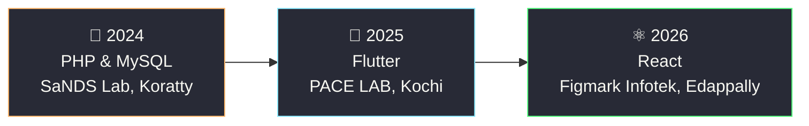

<div align="center">


<a href="https://github.com/Ashwinmv123">
  
</a>

<br/>


<br/><br/>

<a href="https://www.linkedin.com/in/ashwin-mv112"></a>
<a href="mailto:ashwinmv67@gmail.com"></a>


</div>

---

## 🎮 Player Card

<table>
<tr>
<td width="55%" valign="top">

```yaml
PLAYER:      Ashwin MV
HOME BASE:   Thrissur, Kerala, India
SCHOOL:      Nirmala College of Engineering
MAJOR:       Computer Science & Engineering
CLASS:       Cyber-Security / AI Builder
GUILD:       3 internships · 2 hackathons
LANGUAGES:   English · Hindi · Malayalam
SIDE QUEST:  Generative AI + Robotics
GOAL:        Entry-level role / 6-month internship
```

</td>
<td width="45%" align="center" valign="middle">

<br/><br/>
<br/><br/>
<br/><br/>


</td>
</tr>
</table>

---

## 🎒 Inventory

<div align="center">

**⚔️ Main Weapons**<br/>


**🧪 Utility Items**<br/>


**🔮 Special Abilities**<br/>


</div>

---

## 🗡️ Quest Log

<div align="center">
  <a href="https://github.com/Ashwinmv123/sage-ai"></a>
  <a href="https://github.com/Ashwinmv123/FLAG-CLEANUP-AGENT"></a>
</div>

<br/>

### 🛡️ Quest 1 — Sage AI `[BOSS LEVEL]`
*Digital Safety & Harassment Response Platform*
`React` `Vite` `Tailwind` `Node.js` `Express` `SQLite`

> **Mission:** help students and vulnerable users fight cyberstalking, phishing, extortion and impersonation.

| 🏆 Loot | Detail |
|:--|:--|
| 🔎 Threat Radar | Explainable threat-analysis engine with severity scoring |
| 🔐 Evidence Vault | Tamper-evident storage with SHA-256 hashing and forensic metadata |
| 📄 Report Scroll | Printable cyber-crime report for police / cyber cells |
| 🕶️ Stealth Mode | Quick-exit disguise mode |
| 🗝️ Gatekeeper | REST API with user authentication, plus incident tracking |

### 🧹 Quest 2 — Flag Buster `[AGENT SQUAD]`
*Dead Code Cleanup Agent* · `Node.js` `IBM Bob` · [Repo](https://github.com/Ashwinmv123/FLAG-CLEANUP-AGENT)


Finds stale feature flags and unreachable code and proposes safe removals, with JSON handoff contracts, schema validation, a dry-run mode, failure handling, unit tests and a live demo on Vercel.

### 🦠 Quest 3 — SecureShield AI `[DEFENSE TOWER]`
*Hybrid Security Dashboard* · `Python` `Machine Learning` `Nmap` `VirusTotal API`

Desktop antivirus detecting malware with ML and the VirusTotal API, plus a live Nmap scanner that flags vulnerable services against known CVEs.

---

## 🔓 Achievements Unlocked

| | Achievement | Unlocked |
|:-:|:--|:--|
| 🤖 | **IBM Bob 2.0 Hackathon** · Certificate of Completion for outstanding performance (built on Anthropic Claude and Antigravity) | 25–27 Sep 2026 |
| 💡 | **Hack2Pitch, FISAT** · Certificate of Achievement for innovation, creativity and teamwork | — |
| 🔐 | **Introduction to Cybersecurity** · Cisco Networking Academy | Oct 2026 |
| 🚔 | **Cyber First Responder Awareness + Cyber Safety Pledge** · Kerala Police, Cyber Division | — |

---

## 🌍 World Map (Internships)



<details>
<summary><b>📜 Mission reports</b></summary>
<br/>

- **React Intern** · Figmark Infotek Pvt Ltd · 15–30 Jun 2026: built and improved web interfaces using HTML, CSS, JavaScript and React
- **Flutter Intern** · PACE LAB, Kochi · 26 Jun – 9 Jul 2025: built cross-platform mobile interfaces and features with Flutter and Dart
- **PHP & MySQL Intern** · SaNDS Lab · 8–12 Jul 2024: practical exposure to server-side web development and database-driven apps

</details>

---

## 📈 Scoreboard

<div align="center">
  
  
  <br/>
  
  <br/>
  
  <br/>
  
</div>

<!-- Optional snake (needs snake.yml workflow) -->
<div align="center">
  <picture>
    <source media="(prefers-color-scheme: dark)" srcset="https://raw.githubusercontent.com/Ashwinmv123/Ashwinmv123/output/github-snake-dark.svg"/>
    
  </picture>
</div>

---

## 🎓 Training Grounds & 🌱 Skill Tree

| Degree | Institution | Year | Score |
|:--|:--|:-:|:-:|
| B.Tech, Computer Science and Engineering | Nirmala College of Engineering, Chalakudy | 2023 – Present | In progress |
| Higher Secondary (XII) | St George's HSS, Pariyaram | 2023 | 80% |
| Secondary (X) | St George's HSS, Pariyaram | 2021 | 9 A+ and 1 A |

```text
🌳 SKILL TREE (currently unlocking)
 ├─ 🧠 Generative AI     → AI agent pipelines · Claude · IBM Bob
 ├─ 🤖 Robotics          → fundamentals · hands-on builds
 ├─ 🛡️ Cybersecurity     → network security · Nmap · threat analysis
 └─ 🔍 Digital Forensics → evidence integrity · SHA-256
```

<div align="center">

### 💾 SAVE POINT: let's team up!

<a href="mailto:ashwinmv67@gmail.com"></a>

<sub>Open to relocation · Open to global, cross-sectoral opportunities</sub>

</div>


