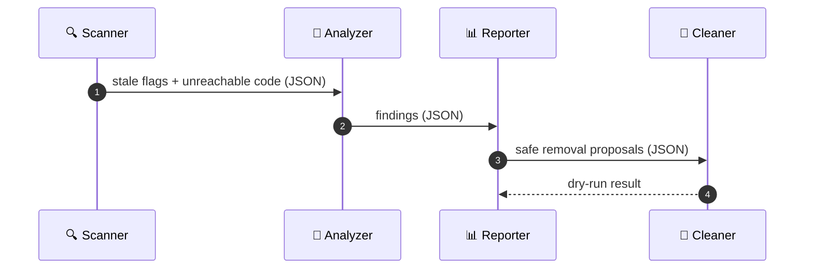
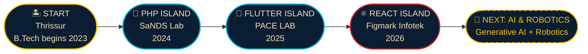

<div align="center">


<a href="https://github.com/Ashwinmv123">
  
</a>

<br/>


<br/><br/>

<a href="https://www.linkedin.com/in/ashwin-mv112"></a>
<a href="mailto:ashwinmv67@gmail.com"></a>


</div>


<div align="center">

<table>
<tr>
<td align="center" width="260">

</td>
<td align="left" valign="middle">

### ASHWIN MV
**Hired by:** Internships & entry-level roles<br/>
**Bounty:** ฿ ∞ *(open to offers)*<br/>
**Last seen:** Thrissur, Kerala, India 🇮🇳<br/>
**Charges:** hunting malware, scanning ports (legally), clearing dead code, building tamper-proof evidence vaults<br/>
**Crew:** 3 internships · 2 hackathons · 2 cyber certifications<br/>
**Languages:** English · Hindi · Malayalam

</td>
</tr>
</table>

<sub>☠️ Wanted for being too useful in a team ☠️</sub>

</div>


<div align="center">
  
</div>

```text
              ___________
             /  _______  \
        ====/__/_______\__\====        ← straw hat
               .-"""""-.
              /  O   O  \
             |     ^     |
              \  \___/  /
          ____'-._____.-'____
         /___/ |  |||  | \___\          ← my own Jolly Roger
              /\  |||  /\
             /  \_|||_/  \
```

<div align="center">

| 🏝️ ISLANDS VISITED | ⚓ INTERNSHIPS | 🏴‍☠️ HACKATHONS | 📜 CERTIFICATES | 🗺️ PROJECTS |
|:-:|:-:|:-:|:-:|:-:|
| **4** | **3** | **2** | **2** | **3** |

</div>


<div align="center">

**🪨 An ancient stone slab: drag to rotate it** *(3D viewer on github.com)*

</div>

```stl
solid poneglyph
  facet normal 0 0 0
    outer loop
      vertex -4 -8 -1
      vertex 4 8 -1
      vertex 4 -8 -1
    endloop
  endfacet
  facet normal 0 0 0
    outer loop
      vertex -4 -8 -1
      vertex -4 8 -1
      vertex 4 8 -1
    endloop
  endfacet
  facet normal 0 0 0
    outer loop
      vertex -4 -8 1
      vertex 4 -8 1
      vertex 4 8 1
    endloop
  endfacet
  facet normal 0 0 0
    outer loop
      vertex -4 -8 1
      vertex 4 8 1
      vertex -4 8 1
    endloop
  endfacet
  facet normal 0 0 0
    outer loop
      vertex -4 -8 -1
      vertex 4 -8 -1
      vertex 4 -8 1
    endloop
  endfacet
  facet normal 0 0 0
    outer loop
      vertex -4 -8 -1
      vertex 4 -8 1
      vertex -4 -8 1
    endloop
  endfacet
  facet normal 0 0 0
    outer loop
      vertex -4 8 -1
      vertex -4 8 1
      vertex 4 8 1
    endloop
  endfacet
  facet normal 0 0 0
    outer loop
      vertex -4 8 -1
      vertex 4 8 1
      vertex 4 8 -1
    endloop
  endfacet
  facet normal 0 0 0
    outer loop
      vertex -4 -8 -1
      vertex -4 -8 1
      vertex -4 8 1
    endloop
  endfacet
  facet normal 0 0 0
    outer loop
      vertex -4 -8 -1
      vertex -4 8 1
      vertex -4 8 -1
    endloop
  endfacet
  facet normal 0 0 0
    outer loop
      vertex 4 -8 -1
      vertex 4 8 -1
      vertex 4 8 1
    endloop
  endfacet
  facet normal 0 0 0
    outer loop
      vertex 4 -8 -1
      vertex 4 8 1
      vertex 4 -8 1
    endloop
  endfacet
endsolid poneglyph
```


<div align="center">

| 🍎 DEVIL FRUIT (SKILL) | POWER | |
|:--|:--|:-:|
| **Python-Python no Mi** | Scripting, ML and security tooling | 🐍 |
| **React-React no Mi** | Fast, component-built interfaces | ⚛️ |
| **Node-Node no Mi** | Server-side power: Express + REST APIs | 🟢 |
| **Flutter-Flutter no Mi** | Cross-platform mobile builds with Dart | 📱 |
| **Scan-Scan no Mi** | Nmap network scanning, VirusTotal lookups | 📡 |

| 👁️ HAKI | HOW I USE IT |
|:--|:--|
| **Observation Haki** | Threat analysis: spotting phishing, extortion and impersonation (Sage AI) |
| **Armament Haki** | Hardening: SHA-256 tamper-evident evidence, authenticated APIs |
| **Conqueror's Haki** | Leading a project from idea to hackathon submission |

</div>

<div align="center">


<br/><br/>


</div>


<div align="center">

<table>
<tr>
<td align="center" width="25%"><br/><b>NAVIGATOR</b><br/><sub>Nmap · network security</sub></td>
<td align="center" width="25%"><br/><b>SHIPWRIGHT</b><br/><sub>React · Vite · Flutter</sub></td>
<td align="center" width="25%"><br/><b>SHIP'S DOCTOR</b><br/><sub>Digital forensics · SHA-256</sub></td>
<td align="center" width="25%"><br/><b>LOOKOUT</b><br/><sub>Threat analysis · ML malware detection</sub></td>
</tr>
</table>

</div>


<table>
<tr>
<td width="110" align="center" valign="top">
<br/><sub>TREASURE 01</sub>
</td>
<td valign="top">

### 🛡️ [Sage AI](https://github.com/Ashwinmv123/sage-ai)
**Digital Safety & Harassment Response Platform** · `React` `Vite` `Tailwind CSS` `Node.js` `Express` `SQLite`

A shelter for students and vulnerable users facing cyberstalking, phishing, extortion and impersonation.

- 🔎 Explainable threat analysis with severity scoring
- 🔐 Tamper-evident evidence vault (SHA-256 hashing + forensic metadata)
- 📄 Incident tracking and printable cyber-crime reports for police / cyber cells
- 🕶️ Quick-exit disguise mode and an authenticated REST API

</td>
</tr>
<tr>
<td width="110" align="center" valign="top">
<br/><sub>TREASURE 02</sub>
</td>
<td valign="top">

### 🧹 [Flag Buster](https://github.com/Ashwinmv123/FLAG-CLEANUP-AGENT)
**Dead Code Cleanup Agent** · `Node.js` `IBM Bob` `Vercel`

A four-agent crew that hunts stale feature flags and unreachable code, then proposes safe removals.

- 📜 JSON handoff contracts with schema validation
- 🧪 Safe dry-run mode, failure handling and unit tests
- 🌐 Live demo hosted on Vercel

</td>
</tr>
<tr>
<td width="110" align="center" valign="top">
<br/><sub>TREASURE 03</sub>
</td>
<td valign="top">

### 🦠 SecureShield AI
**Hybrid Security Dashboard** · `Python` `Machine Learning` `Nmap` `VirusTotal API`

Desktop antivirus that detects malware using machine learning and the VirusTotal API, with a live Nmap scanner that flags vulnerable system services against known CVEs.

</td>
</tr>
</table>



<div align="center">
  <a href="https://github.com/Ashwinmv123/sage-ai"></a>
  <a href="https://github.com/Ashwinmv123/FLAG-CLEANUP-AGENT"></a>
</div>




<div align="center">

**🧭 My treasure map of Kerala** *(interactive map on github.com; pins are approximate)*

</div>

```geojson
{
  "type": "FeatureCollection",
  "features": [
    { "type": "Feature", "properties": { "title": "Thrissur · Home island", "marker-color": "#FFC300", "marker-symbol": "star", "marker-size": "large" }, "geometry": { "type": "Point", "coordinates": [76.2144, 10.5276] } },
    { "type": "Feature", "properties": { "title": "Chalakudy · Nirmala College of Engineering", "marker-color": "#0077B6", "marker-symbol": "college" }, "geometry": { "type": "Point", "coordinates": [76.3333, 10.3069] } },
    { "type": "Feature", "properties": { "title": "Koratty · PHP Island (SaNDS Lab, 2024)", "marker-color": "#D62828", "marker-symbol": "1" }, "geometry": { "type": "Point", "coordinates": [76.35, 10.27] } },
    { "type": "Feature", "properties": { "title": "Kochi · Flutter Island (PACE LAB, 2025)", "marker-color": "#D62828", "marker-symbol": "2" }, "geometry": { "type": "Point", "coordinates": [76.2673, 9.9312] } },
    { "type": "Feature", "properties": { "title": "Edappally · React Island (Figmark Infotek, 2026)", "marker-color": "#D62828", "marker-symbol": "3" }, "geometry": { "type": "Point", "coordinates": [76.3085, 10.0261] } },
    { "type": "Feature", "properties": { "title": "Course", "stroke": "#FFC300", "stroke-width": 3, "stroke-opacity": 0.9 }, "geometry": { "type": "LineString", "coordinates": [[76.2144, 10.5276], [76.3333, 10.3069], [76.35, 10.27], [76.3085, 10.0261], [76.2673, 9.9312]] } }
  ]
}
```

<details>
<summary><b>📜 OPEN THE SHIP'S LOGBOOK</b></summary>
<br/>

| ROLE | ORGANISATION | WINDOW | PORT | WHAT I DID |
|:--|:--|:--|:--|:--|
| Web Development using React Intern | Figmark Infotek Pvt Ltd | 15–30 Jun 2026 | Edappally, Ernakulam | Built and improved web interfaces with HTML, CSS, JavaScript and React |
| Flutter Intern | PACE LAB | 26 Jun – 9 Jul 2025 | Kochi | Built cross-platform mobile interfaces and features with Flutter and Dart |
| PHP & MySQL Intern | SaNDS Lab | 8–12 Jul 2024 | Trichur Infopark, Koratty | Server-side web development and database-driven apps |

</details>


<div align="center">

| | BOUNTY | DETAILS |
|:-:|:--|:--|
| 🤖 | **IBM Bob 2.0 Hackathon** | Certificate of Completion for outstanding performance · LabLab.ai / NativelyAI · 25–27 Sep 2026 · built on Anthropic Claude and Antigravity |
| 💡 | **Hack2Pitch, FISAT** | Certificate of Achievement for innovation, creativity and collaborative problem-solving |
| 🔐 | **Introduction to Cybersecurity** | Cisco Networking Academy · Oct 2026 |
| 🚔 | **Cyber First Responder Awareness** | Kerala Police, Cyber Division · Cyber Safety Pledge |

</div>


<div align="center">


</div>


<div align="center">

| DEGREE | INSTITUTION | YEAR | SCORE |
|:--|:--|:-:|:-:|
| B.Tech, Computer Science and Engineering | Nirmala College of Engineering, Chalakudy | 2023 – Present | In progress |
| Higher Secondary (XII) | St George's HSS, Pariyaram | 2023 | 80% |
| Secondary (X) | St George's HSS, Pariyaram | 2021 | 9 A+ and 1 A |

</div>

```text
🧭 NEXT DESTINATIONS (Log Pose is pointing to...)
 ├─ 🧠 Generative AI     → AI agent pipelines · Anthropic Claude · IBM Bob
 ├─ 🤖 Robotics          → fundamentals · hands-on builds
 ├─ 🛡️ Cybersecurity     → network security · Nmap · threat analysis
 └─ 🔍 Digital Forensics → evidence integrity · SHA-256 hashing
```

<details>
<summary><b>🍖 CREW RULES (click)</b></summary>
<br/>

- 🗣️ I speak English, Hindi and Malayalam
- 🛡️ I've completed Kerala Police's Cyber First Responder Awareness Programme and signed the Cyber Safety Pledge
- 🏁 First voyage: 2024 (PHP & MySQL). Latest: 2026 (React)
- 🌍 Open to global, cross-sectoral opportunities, and ready to relocate

</details>


<div align="center">

**🐌 Pick up the call. I'm ready to join your crew!**

<table>
<tr>
<td align="center"><a href="https://www.linkedin.com/in/ashwin-mv112"></a><br/><sub><b>LINKEDIN</b></sub></td>
<td align="center"><a href="https://github.com/Ashwinmv123"></a><br/><sub><b>GITHUB</b></sub></td>
<td align="center"><a href="mailto:ashwinmv67@gmail.com"></a><br/><sub><b>EMAIL</b></sub></td>
</tr>
</table>

<a href="https://github.com/Ashwinmv123">
  
</a>

<br/>

<sub>🏴‍☠️ Fan-made pirate-adventure theme in tribute to <i>One Piece</i> (© Eiichiro Oda / Shueisha / Toei Animation). Not affiliated with or endorsed by the rights holders; all artwork here is original or generated.</sub>

</div>


