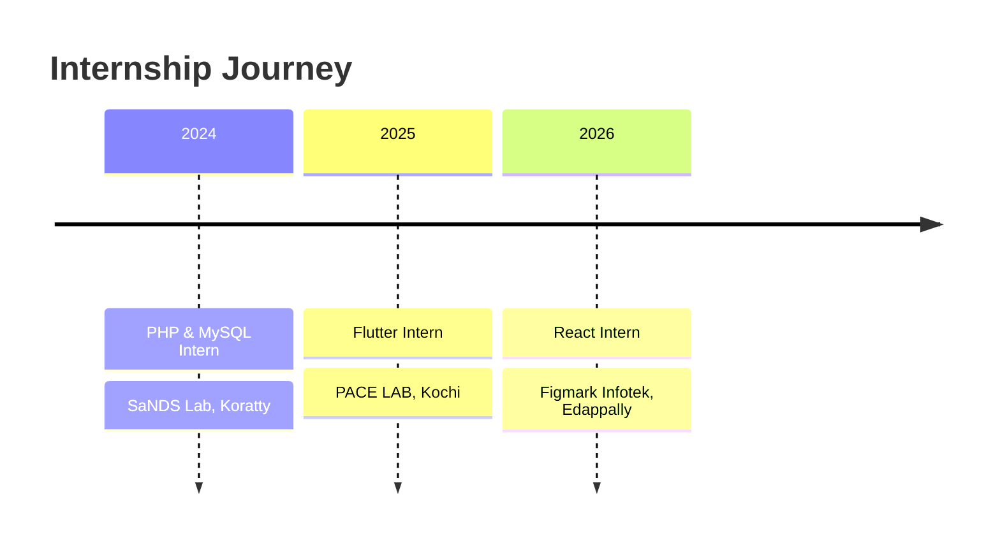

<div align="center">


<a href="https://github.com/Ashwinmv123">
  
</a>

<br/>

<a href="https://www.linkedin.com/in/ashwin-mv112"></a>
<a href="mailto:ashwinmv67@gmail.com"></a>
<a href="https://github.com/Ashwinmv123?tab=repositories"></a>


<br/><br/>


</div>


## 🖥️ `~/about-me`

<table>
<tr>
<td width="60%" valign="top">

```python
class Ashwin:
    name       = "Ashwin MV"
    location   = "Thrissur, Kerala, India 🇮🇳"
    degree     = "B.Tech CSE @ Nirmala College of Engineering"
    focus      = ["AI / ML", "Cybersecurity", "Full-Stack", "Mobile"]
    internships = 3
    hackathons  = ["IBM Bob 2.0", "Hack2Pitch"]
    learning   = ["Generative AI", "Robotics"]
    languages  = ["English", "Hindi", "Malayalam"]
    looking_for = "Entry-level role / 6-month internship"

    def motto(self):
        return "Build tools that keep people safe online 🔐"
```

</td>
<td width="40%" align="center" valign="middle">

<br/><br/>
<br/><br/>
<br/><br/>


</td>
</tr>
</table>


## ⚡ Tech Arsenal

<div align="center">


<br/><br/>


</div>


## 🚀 Featured Projects

<table>
<tr>
<td width="50%" valign="top">

### 🛡️ [Sage AI](https://github.com/Ashwinmv123/sage-ai)
**Digital Safety & Harassment Response Platform**

`React` `Vite` `Tailwind CSS` `Node.js` `Express` `SQLite`

Helps students and vulnerable users respond to cyberstalking, phishing, extortion and impersonation.

- 🔎 Explainable threat analysis with severity scoring
- 🔐 Tamper-evident evidence vault (SHA-256 + forensic metadata)
- 📄 Printable cyber-crime report for police / cyber cells
- 🕶️ Quick-exit disguise mode, authenticated REST API

</td>
<td width="50%" valign="top">

### 🧹 [Flag Buster](https://github.com/Ashwinmv123/FLAG-CLEANUP-AGENT)
**Dead Code Cleanup Agent**

`Node.js` `IBM Bob` `Vercel`

Multi-agent pipeline that finds stale feature flags and unreachable code and proposes safe removals.

- 📜 JSON handoff contracts with schema validation
- 🧪 Safe dry-run mode, failure handling, unit tests
- 🌐 Live demo hosted on Vercel

</td>
</tr>
<tr>
<td colspan="2" valign="top">

### 🦠 SecureShield AI
**Hybrid Security Dashboard** · `Python` `Machine Learning` `Nmap` `VirusTotal API`

Desktop antivirus that detects malware using machine learning and the VirusTotal API, with a live Nmap scanner that flags vulnerable services against known CVEs.

</td>
</tr>
</table>


## 💼 Experience



<details open>
<summary><b>⚛️ Web Development using React Intern</b> · Figmark Infotek Pvt Ltd · 15–30 Jun 2026 · Edappally, Ernakulam</summary>

- Built and improved web application interfaces
- Applied HTML, CSS, JavaScript and React in practical projects

</details>

<details>
<summary><b>📱 Flutter Intern</b> · PACE LAB · 26 Jun – 9 Jul 2025 · Kochi</summary>

- Two-week internship building cross-platform mobile app interfaces and features with Flutter and Dart

</details>

<details>
<summary><b>🐘 PHP & MySQL Intern</b> · SaNDS Lab · 8–12 Jul 2024 · Trichur Infopark, Koratty</summary>

- Practical exposure to server-side web development and database-driven applications

</details>


## 🏆 Achievements

| | Achievement | Details |
|:-:|:--|:--|
| 🤖 | **IBM Bob 2.0 Hackathon** | Certificate of Completion for outstanding performance · LabLab.ai / NativelyAI · 25–27 Sep 2026 · built on Anthropic Claude and Antigravity |
| 💡 | **Hack2Pitch, FISAT** | Certificate of Achievement for innovation, creativity and collaborative problem-solving |
| 🔐 | **Introduction to Cybersecurity** | Cisco Networking Academy · Oct 2026 |
| 🚔 | **Cyber First Responder Awareness** | Kerala Police, Cyber Division · Cyber Safety Pledge |


## 📊 GitHub Stats

<div align="center">


</div>


## 🎓 Education & 🌱 Learning

<div align="center">

| Degree | Institution | Year | Score |
|:--|:--|:-:|:-:|
| B.Tech, Computer Science and Engineering | Nirmala College of Engineering, Chalakudy | 2023 – Present | In progress |
| Higher Secondary (XII) | St George's HSS, Pariyaram | 2023 | 80% |
| Secondary (X) | St George's HSS, Pariyaram | 2021 | 9 A+ and 1 A |

</div>

```text
🧠 Generative AI     → AI agent pipelines · Anthropic Claude · IBM Bob
🤖 Robotics          → fundamentals · hands-on builds
🛡️ Cybersecurity     → network security · Nmap · threat analysis
🔍 Digital Forensics → evidence integrity · SHA-256 hashing
```

**🗣️ Languages:** English · Hindi · Malayalam

<div align="center">

<a href="https://github.com/Ashwinmv123">
  
</a>

<a href="mailto:ashwinmv67@gmail.com"></a>

</div>


