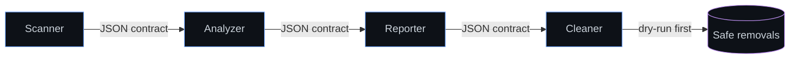

<div align="center">


<a href="https://github.com/Ashwinmv123">
  
</a>

<br/><br/>

<a href="mailto:ashwinmv67@gmail.com"></a>
<a href="https://linkedin.com/in/ashwin-mv112"></a>


</div>

---

## About


```python
class Ashwin:
    name      = "Ashwin MV"
    location  = "Thrissur, Kerala, India"
    degree    = "B.Tech CSE, Nirmala College of Engineering (2023 - Present)"
    languages = ["English", "Hindi", "Malayalam"]

    stack = ["Python", "JavaScript", "Node.js", "React",
             "Express", "Tailwind CSS", "Flutter", "MySQL"]

    focus = ["AI / ML", "Cybersecurity", "Digital Forensics"]

    currentlyLearning = ["Generative AI", "AI Agent Pipelines", "Robotics"]

    lookingFor = "Entry-level role or 6-month internship"

    def motto(self):
        return "Build it safe. Build it explainable."
```

<br clear="right"/>

Computer Science undergraduate with a foundation in AI, Machine Learning, cybersecurity and web/mobile development. Three internships and hands-on projects in Python, JavaScript and React. Open to relocation and to global, cross-sectoral opportunities.

---

## Technical Skills

<div align="center">

**Languages & Web**<br/>


**Frameworks & Libraries**<br/>


**Cloud & Security**<br/>


**Databases**<br/>


**AI & Tools**<br/>


</div>

---

## GitHub Overview

<div align="center">
  <a href="https://github.com/Ashwinmv123">
    
  </a>
  <a href="https://github.com/Ashwinmv123">
    
  </a>
  <br/>
  
  <br/>
  
  <br/>
  
</div>

---

## Experience

<details open>
<summary><b>Web Development using React Intern</b> | Figmark Infotek Pvt Ltd | 15 Jun 2026 – 30 Jun 2026 | Edappally, Ernakulam</summary>
<br/>

> `React` `JavaScript` `HTML` `CSS`

- Built and improved web application interfaces using React in practical, hands-on projects
- Applied HTML, CSS and JavaScript fundamentals to responsive UI components

</details>

<details>
<summary><b>Flutter Intern</b> | PACE LAB | 26 Jun – 9 Jul 2025 | Kochi</summary>
<br/>

> `Flutter` `Dart`

- Completed a two-week internship building cross-platform mobile app interfaces and features

</details>

<details>
<summary><b>PHP & MySQL Intern</b> | SaNDS Lab | 8 Jul – 12 Jul 2024 | Trichur Infopark, Koratty</summary>
<br/>

> `PHP` `MySQL`

- Gained practical exposure to server-side web development and database-driven applications

</details>

---

## Featured Projects

<div align="center">

| Project | Stack | Highlights |
|:--|:--|:--|
| **[Sage AI](https://github.com/Ashwinmv123/sage-ai)**<br/>Digital Safety & Harassment Response Platform | `React` `Vite` `Tailwind` `Node.js` `Express` `SQLite` | Full-stack platform helping students and vulnerable users respond to cyberstalking, phishing, extortion and impersonation. Explainable threat-analysis engine with severity scoring; tamper-evident evidence vault (SHA-256 + forensic metadata); incident tracking; printable cyber-crime reports for police; quick-exit disguise mode; REST API with authentication. |
| **[Flag Buster](https://github.com/Ashwinmv123/FLAG-CLEANUP-AGENT)**<br/>Dead Code Cleanup Agent | `Node.js` `IBM Bob` | Multi-agent pipeline (scanner, analyzer, reporter, cleaner) that finds stale feature flags and unreachable code and proposes safe removals. JSON handoff contracts with schema validation, dry-run mode, failure handling and unit tests. Live demo hosted on Vercel. |
| **SecureShield AI**<br/>Hybrid Security Dashboard | `Python` `ML` `Nmap` `VirusTotal API` | Desktop antivirus detecting malware via machine learning and the VirusTotal API, with a live Nmap scanner that flags vulnerable services against known CVEs. |

</div>



<div align="center"><sub>Flag Buster agent pipeline</sub></div>

---

## Hackathons & Certifications

<div align="center">

| Type | Title | Details |
|:--|:--|:--|
| Hackathon | **IBM Bob 2.0 Hackathon** (LabLab.ai / NativelyAI) | Certificate of Completion for outstanding performance, 25–27 Sep 2026. Submitted a solution based on Anthropic Claude and Antigravity |
| Hackathon | **Hack2Pitch, FISAT** | Certificate of Achievement for innovation, creativity and collaborative problem-solving |
| Certification | **Introduction to Cybersecurity** | Cisco Networking Academy, Oct 2026 |
| Certification | **Cyber First Responder Awareness Programme & Cyber Safety Pledge** | Kerala Police, Cyber Division |

</div>

---

## Education

<div align="center">

| Degree | Institution | Year | Score |
|:--|:--|:-:|:-:|
| B.Tech, Computer Science & Engineering | Nirmala College of Engineering, Chalakudy, Kerala | 2023 – Present | In progress |
| Higher Secondary (Class XII) | St George's HSS, Pariyaram, Kerala | 2023 | 80% |
| Secondary School (Class X) | St George's HSS, Pariyaram, Kerala | 2021 | 9 A+ and 1 A |

</div>

## Currently Learning

```
Generative AI   -> LLM applications, AI agent pipelines
Robotics        -> Fundamentals, sensors, automation
Cybersecurity   -> Network security, digital forensics
Cloud           -> AWS, IBM Cloud
```

## Contact

<div align="center">

Seeking an entry-level role or a 6-month internship. Open to relocation and global opportunities.

<a href="mailto:ashwinmv67@gmail.com"></a>
<a href="https://linkedin.com/in/ashwin-mv112"></a>

<br/><br/>


</div>
