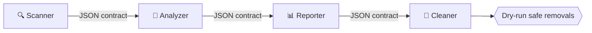
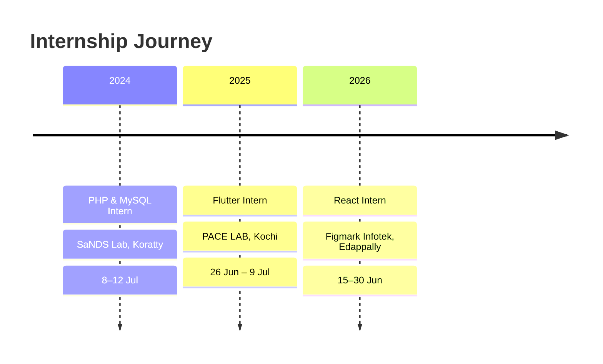

<!-- HERO -->
<div align="center">
  
</div>

<div align="center">
  <a href="https://github.com/Ashwinmv123">
    
  </a>
</div>

<p align="center">
  
  
  
</p>

<p align="center">
  <a href="https://www.linkedin.com/in/ashwin-mv112"></a>
  <a href="mailto:ashwinmv67@gmail.com"></a>
  <a href="https://github.com/Ashwinmv123"></a>
  
</p>

---

## 🖥️ `~/about-me`

```bash
ashwin@thrissur:~$ neofetch

  ┌──────────────────────────────────────────────────────┐
  │  👤 Name        Ashwin MV                            │
  │  🎓 Degree      B.Tech CSE · Nirmala College (2023–) │
  │  📍 Location    Thrissur, Kerala, India              │
  │  🧠 Focus       AI/ML · Cybersecurity · Web & Mobile │
  │  🛠️ Internships 3 (React · Flutter · PHP/MySQL)      │
  │  🏅 Hackathons  IBM Bob 2.0 · Hack2Pitch             │
  │  🌍 Languages   English · Hindi · Malayalam          │
  │  🎯 Looking for Entry-level role / 6-month internship│
  └──────────────────────────────────────────────────────┘

ashwin@thrissur:~$ echo $MOTTO
"Make the internet a safer place — one tool at a time."
```

---

## ⚡ Tech Arsenal

<div align="center">

**Build**<br/>


**Data, Cloud & Tools**<br/>


<br/>


</div>

---

## 🚀 Featured Projects

<table>
<tr>
<td width="50%" valign="top">

### 🛡️ [Sage AI](https://github.com/Ashwinmv123/sage-ai)
*Digital Safety & Harassment Response Platform*

`React` `Vite` `Tailwind` `Node.js` `Express` `SQLite`

Helps students and vulnerable users respond to **cyberstalking, phishing, extortion and impersonation**.

- 🔎 Explainable threat analysis with severity scoring
- 🔐 Tamper-evident evidence vault (SHA-256 + forensic metadata)
- 📄 Printable cyber-crime report for police/cyber cells
- 🕶️ Quick-exit disguise mode + authenticated REST API

</td>
<td width="50%" valign="top">

### 🧹 [Flag Buster](https://github.com/Ashwinmv123/FLAG-CLEANUP-AGENT)
*Dead Code Cleanup Agent*

`Node.js` `IBM Bob` `Vercel`

Multi-agent pipeline that finds **stale feature flags and unreachable code** and proposes safe removals.

- 📜 JSON handoff contracts with schema validation
- 🧪 Safe dry-run mode, failure handling, unit tests
- 🌐 Live demo hosted on Vercel

</td>
</tr>
<tr>
<td colspan="2" valign="top">

### 🦠 SecureShield AI
*Hybrid Security Dashboard* · `Python` `Machine Learning` `Nmap` `VirusTotal API`

Desktop antivirus that detects malware using **machine learning + the VirusTotal API**, with a live **Nmap scanner** that flags vulnerable services against known CVEs.

</td>
</tr>
</table>

### 🔄 How Flag Buster Works



---

## 📊 Stats

<div align="center">
  
  
</div>

<div align="center">
  
</div>

<div align="center">
  
</div>

<!-- Snake animation: needs the workflow file snake.yml (included separately) -->
<div align="center">
  <picture>
    <source media="(prefers-color-scheme: dark)" srcset="https://raw.githubusercontent.com/Ashwinmv123/Ashwinmv123/output/github-snake-dark.svg"/>
    
  </picture>
</div>

---

## 🎖️ Level-Ups & Achievements

| | Milestone | Details |
|:-:|:--|:--|
| 🤖 | **IBM Bob 2.0 Hackathon** | Certificate of Completion for outstanding performance · LabLab.ai / NativelyAI · 25–27 Sep 2026 · Anthropic Claude + Antigravity solution |
| 💡 | **Hack2Pitch, FISAT** | Certificate of Achievement: innovation, creativity, collaborative problem-solving |
| 🔐 | **Intro to Cybersecurity** | Cisco Networking Academy · Oct 2026 |
| 🚔 | **Cyber First Responder Awareness** | Kerala Police, Cyber Division · Cyber Safety Pledge |

---

## 💼 Experience Timeline



<details>
<summary><b>⚛️ Web Development using React Intern</b> · Figmark Infotek · Jun 2026</summary>

- Built and improved web application interfaces
- Applied HTML, CSS, JavaScript and React in practical projects

</details>

<details>
<summary><b>📱 Flutter Intern</b> · PACE LAB, Kochi · Jun–Jul 2025</summary>

- Two-week internship building cross-platform mobile app interfaces and features with Flutter and Dart

</details>

<details>
<summary><b>🐘 PHP & MySQL Intern</b> · SaNDS Lab, Koratty · Jul 2024</summary>

- Hands-on exposure to server-side web development and database-driven applications

</details>

---

## 🎓 Education & 🌱 Learning

| Degree | Institution | Year | Score |
|:--|:--|:-:|:-:|
| B.Tech CSE | Nirmala College of Engineering, Chalakudy | 2023 – Present | In progress |
| Class XII | St George's HSS, Pariyaram | 2023 | 80% |
| Class X | St George's HSS, Pariyaram | 2021 | 9 A+, 1 A |

```text
🧠 Generative AI     → AI agent pipelines · Claude · IBM Bob
🤖 Robotics          → fundamentals · hands-on builds
🛡️ Cybersecurity     → network security · Nmap · threat analysis
🔍 Digital Forensics → evidence integrity · SHA-256
```

<div align="center">

### 📫 Let's build something safe & smart together

<a href="mailto:ashwinmv67@gmail.com"></a>

</div>


name: Generate Snake Animation

on:
  schedule:
    - cron: "0 */12 * * *"
  workflow_dispatch:
  push:
    branches: [main]

permissions:
  contents: write

jobs:
  generate:
    runs-on: ubuntu-latest
    steps:
      - uses: Platane/snk/svg-only@v3
        with:
          github_user_name: ${{ github.repository_owner }}
          outputs: |
            dist/github-snake.svg
            dist/github-snake-dark.svg?palette=github-dark

      - uses: crazy-max/ghaction-github-pages@v3.1.0
        with:
          target_branch: output
          build_dir: dist
        env:
          GITHUB_TOKEN: ${{ secrets.GITHUB_TOKEN }}
