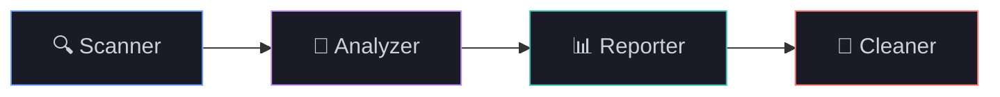
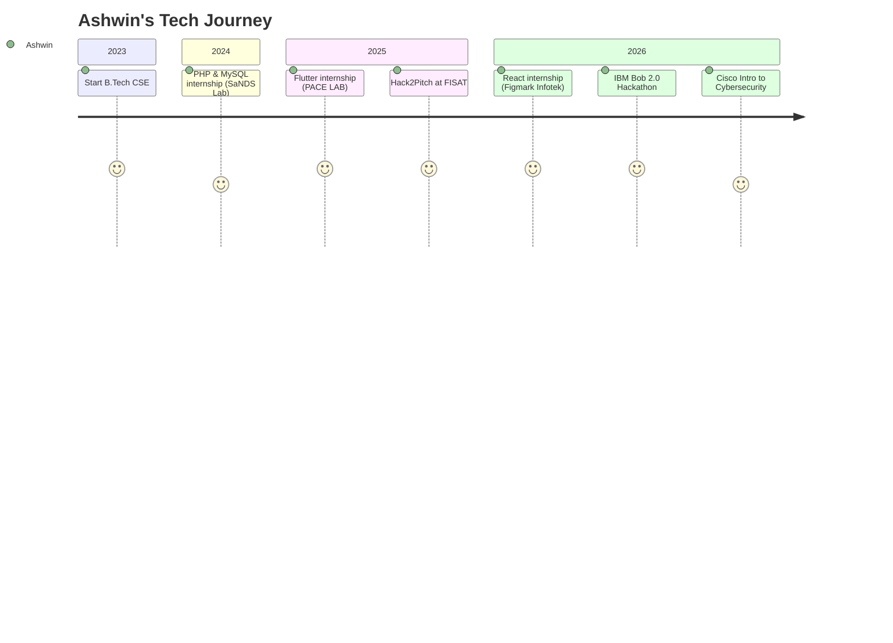

<div align="center">


<a href="https://github.com/Ashwinmv123">
  
</a>

<br/><br/>

<a href="https://www.linkedin.com/in/ashwin-mv112"></a>
<a href="mailto:ashwinmv67@gmail.com"></a>
<a href="https://github.com/Ashwinmv123?tab=repositories"></a>


</div>


## 👨‍💻 Hello, World!

<table>
<tr>
<td width="62%" valign="top">

```js
const ashwin = {
  name: "Ashwin MV",
  location: "Thrissur, Kerala 🇮🇳",
  education: "B.Tech CSE @ Nirmala College of Engineering",
  focus: ["AI / ML", "Cybersecurity", "Full-Stack Web", "Mobile"],
  internships: 3,
  hackathons: ["IBM Bob 2.0", "Hack2Pitch"],
  learning: ["Generative AI", "Robotics"],
  languages: ["English", "Hindi", "Malayalam"],
  lookingFor: "Entry-level role or 6-month internship",
  relocation: true,
  motto: () => "Build things that keep people safe online. 🔐",
};
```

</td>
<td width="38%" align="center" valign="middle">

<br/><br/>
<br/><br/>
<br/><br/>


</td>
</tr>
</table>


## 🧰 Skills

<div align="center">


<br/><br/>


</div>


## 🚀 Featured Projects

<div align="center">
  <a href="https://github.com/Ashwinmv123/sage-ai">
    
  </a>
  <a href="https://github.com/Ashwinmv123/FLAG-CLEANUP-AGENT">
    
  </a>
</div>

<br/>

<details open>
<summary><b>🛡️ Sage AI — Digital Safety & Harassment Response Platform</b></summary>
<br/>

> `React` `Vite` `Tailwind CSS` `Node.js` `Express` `SQLite`

Helps students and vulnerable users respond to **cyberstalking, phishing, extortion and impersonation**.

- 🔎 Explainable threat-analysis engine with severity scoring
- 🔐 Tamper-evident evidence vault using SHA-256 hashing and forensic metadata
- 📋 Incident tracking and a printable cyber-crime report generator for police/cyber cells
- 🕶️ Quick-exit disguise mode and a REST API with user authentication

</details>

<details open>
<summary><b>🧹 Flag Buster — Dead Code Cleanup Agent</b></summary>
<br/>

> `Node.js` `IBM Bob` `Vercel`



- Finds stale feature flags and unreachable code, then proposes safe removals
- JSON handoff contracts with schema validation, dry-run mode, failure handling and unit tests
- Live demo hosted on Vercel

</details>

<details>
<summary><b>🦠 SecureShield AI — Hybrid Security Dashboard</b></summary>
<br/>

> `Python` `Machine Learning` `Nmap` `VirusTotal API`

- Desktop antivirus that detects malware using machine learning and the VirusTotal API
- Live Nmap network scanner flags vulnerable system services against known CVEs

</details>


## 📊 GitHub Analytics

<div align="center">
  
  
  <br/>
  
  <br/>
  
  <br/>
  
</div>

<!-- Optional snake: needs snake.yml workflow; delete if unused -->
<div align="center">
  <picture>
    <source media="(prefers-color-scheme: dark)" srcset="https://raw.githubusercontent.com/Ashwinmv123/Ashwinmv123/output/github-snake-dark.svg"/>
    
  </picture>
</div>


## 🗺️ My Journey



<details>
<summary><b>💼 Experience details</b></summary>
<br/>

| Role | Company | When | Where |
|:--|:--|:--|:--|
| Web Development using React Intern | Figmark Infotek Pvt Ltd | 15–30 Jun 2026 | Edappally, Ernakulam |
| Flutter Intern | PACE LAB | 26 Jun – 9 Jul 2025 | Kochi |
| PHP & MySQL Intern | SaNDS Lab | 8–12 Jul 2024 | Trichur Infopark, Koratty |

</details>

## 🏅 Achievements

<div align="center">

| | Achievement | Details |
|:-:|:--|:--|
| 🤖 | **IBM Bob 2.0 Hackathon** | Certificate of Completion for outstanding performance · LabLab.ai / NativelyAI · 25–27 Sep 2026 · built on Anthropic Claude and Antigravity |
| 💡 | **Hack2Pitch, FISAT** | Certificate of Achievement for innovation, creativity and collaborative problem-solving |
| 🔐 | **Introduction to Cybersecurity** | Cisco Networking Academy · Oct 2026 |
| 🚔 | **Cyber First Responder Awareness** | Kerala Police, Cyber Division · Cyber Safety Pledge |

</div>

## 🎓 Education & Learning

<div align="center">

| Degree | Institution | Year | Score |
|:--|:--|:-:|:-:|
| B.Tech, Computer Science and Engineering | Nirmala College of Engineering, Chalakudy | 2023 – Present | In progress |
| Higher Secondary (XII) | St George's HSS, Pariyaram | 2023 | 80% |
| Secondary (X) | St George's HSS, Pariyaram | 2021 | 9 A+ and 1 A |

</div>

```text
🧠 Generative AI     → AI agent pipelines · Anthropic Claude · IBM Bob
🤖 Robotics          → fundamentals · hands-on builds
🛡️ Cybersecurity     → network security · Nmap · threat analysis
🔍 Digital Forensics → evidence integrity · SHA-256 hashing
```

<div align="center">

### 💬 Let's connect, I'd love to build something with you!

<a href="mailto:ashwinmv67@gmail.com"></a>

<sub>Open to relocation · Open to global, cross-sectoral opportunities</sub>

</div>


